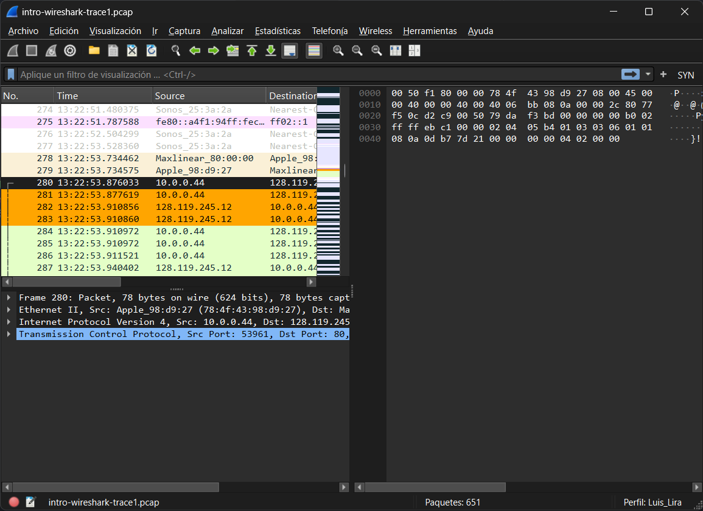
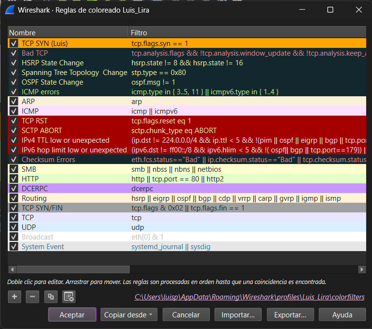
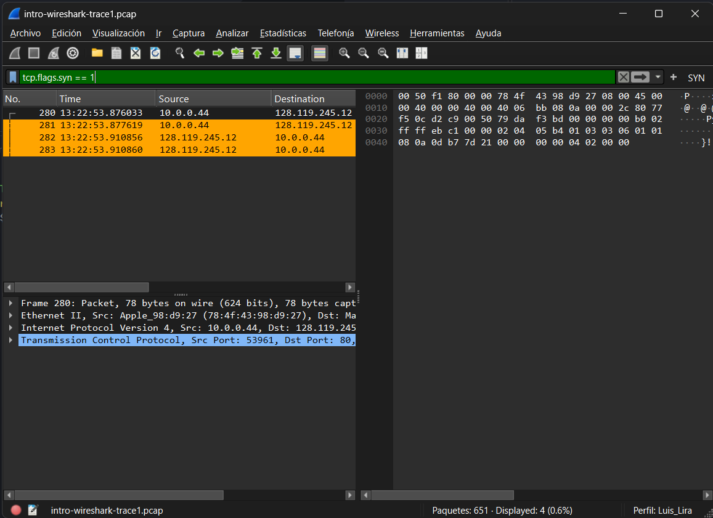
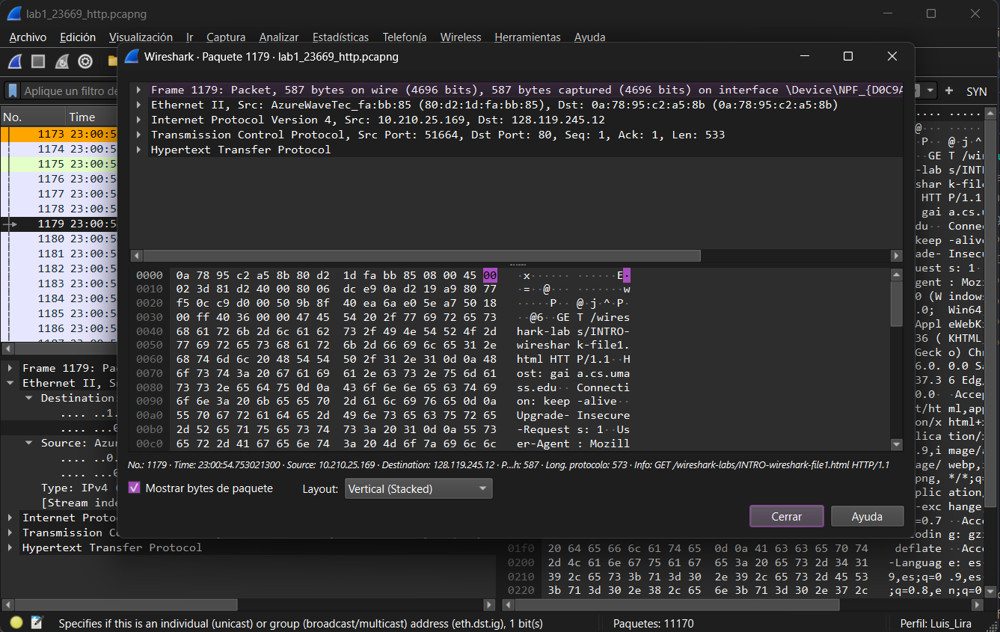
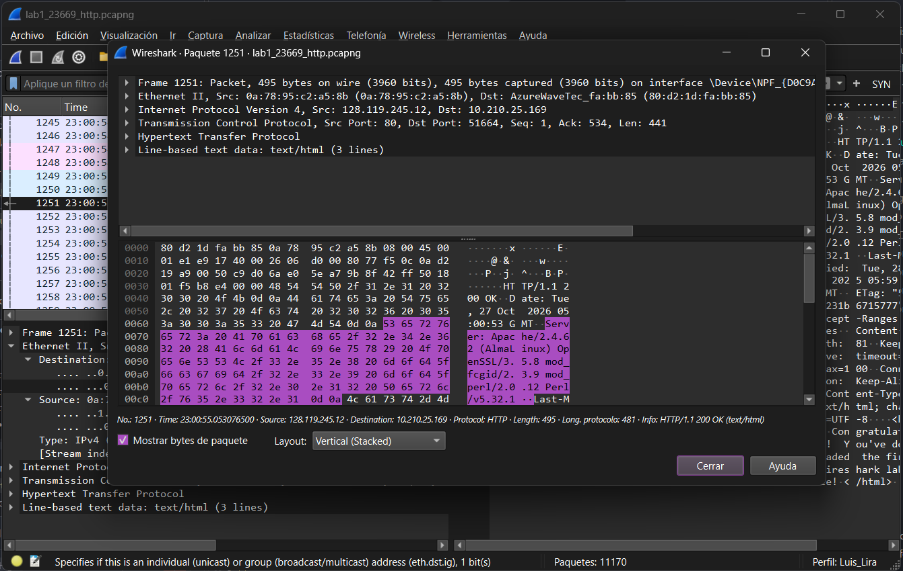

# Laboratorio #1 – Introducción a Wireshark (Reporte individual)

**Universidad del Valle de Guatemala** · CC3067 Redes · Semestre II 2026

**Nombre:** Luis Pedro Lira · **Carnet:** 23669

## 1. Introducción

Wireshark es un analizador de paquetes que captura el tráfico que pasa por una interfaz de red y lo decodifica capa
por capa (Ethernet, IP, TCP/UDP, HTTP, etc.). En esta parte se personalizó el entorno de Wireshark 4.6.9 (con Npcap
1.90 en Windows 11), se hizo una captura continua con *ring buffer* y se analizó una transacción HTTP real entre el
navegador y el servidor `gaia.cs.umass.edu`. Además, se capturó con Wireshark el tráfico del conmutador programado
para la Parte 1.

Archivos de captura incluidos en el repositorio:

| Archivo | Contenido |
|---|---|
| `capturas_ring_buffer/lab1_23669_000NN_*.pcapng` | 10 archivos del ring buffer (5 MB cada uno) |
| `capturas/lab1_23669_http.pcapng` | Captura de la página `INTRO-wireshark-file1.html` por HTTP |
| `capturas/lab1_23669_intento_https.pcapng` | Primer intento: el navegador cargó la página por HTTPS |
| `capturas/lab1_23669_conmutador.pcapng` | Tráfico del conmutador de la Parte 1 (loopback, puerto 5050) |

## 2. Personalización del entorno (3.4)

| Paso | Configuración aplicada |
|---|---|
| Perfil | `Edit → Configuration Profiles → +` → perfil **Luis_Lira** |
| Formato de tiempo | `View → Time Display Format → Time of Day` |
| Columna nueva | `Edit → Preferences → Appearance → Columns → +`, tipo *Custom*, campo `ip.len`, título "Long. protocolo" (longitud total del datagrama IP: encabezado IP + datos) |
| Columna Longitud | Clic derecho en el encabezado de columnas → desmarcar **Length** |
| Paneles | `Edit → Preferences → Appearance → Layout` → esquema 5 (lista de paquetes arriba; detalle y bytes lado a lado abajo), distinto al predeterminado (2) |
| Regla de color | `View → Coloring Rules → +`, nombre "TCP SYN (Luis)", filtro `tcp.flags.syn == 1`, fondo naranja y texto negro, en primer lugar de la lista |
| Botón de filtro | `+` en la barra de filtros (esquina superior derecha), etiqueta **SYN**, filtro `tcp.flags.syn == 1` |
| Interfaces virtuales | `Capture → Options → Manage Interfaces` → se ocultaron Wi-Fi Direct y WAN Miniport ("Conexión de área local\*"), Bluetooth, VirtualBox (Ethernet 3), Tailscale, loopback y las interfaces remotas extcap (ciscodump, sshdump, udpdump, wifidump). Quedan visibles **Wi-Fi** y **Ethernet** |

En la traza del catedrático, el botón **SYN** filtra 4 paquetes, que además aparecen en naranja por la regla de
color. Son los dos `SYN` que envía el navegador (puertos 53961 y 53962 → 80) y los dos `SYN, ACK` con los que
responde el servidor `128.119.245.12`. Es decir, el inicio del *three-way handshake* de dos conexiones TCP abiertas
en paralelo.




*Figura: el perfil en la barra de estado, la hora del día, la columna nueva, el esquema de paneles y los paquetes SYN en naranja.*




*Figura: el diálogo de reglas de color.*




*Figura: el botón SYN aplicado.*


**Interfaces de captura.** `dumpcap -D` lista 11 interfaces de Npcap y Wireshark agrega 4 interfaces remotas
(extcap). En el perfil `Luis_Lira` se ocultaron todas las virtuales mediante la preferencia `capture.devices_hide`
(archivo `%APPDATA%\Wireshark\profiles\Luis_Lira\preferences`). La lista simplificada que muestra Wireshark queda
así:

| Interfaz | Estado en el perfil |
|---|---|
| **Wi-Fi** (`\Device\NPF_{D0C9A476-…}`) | Visible: interfaz física activa, usada en todas las capturas |
| **Ethernet** (`\Device\NPF_{D0FD3717-…}`) | Visible: interfaz física (sin cable) |
| Conexión de área local\* 1, 2, 8, 9 y 10 | Oculta: Wi-Fi Direct y WAN Miniport (virtuales) |
| Conexión de red Bluetooth | Oculta: red de área personal |
| Ethernet 3 | Oculta: adaptador *Host-Only* de VirtualBox |
| Tailscale | Oculta: túnel VPN |
| Adapter for loopback traffic capture | Oculta: tráfico interno del equipo (solo se usó por línea de comandos para capturar el conmutador) |
| ciscodump, sshdump, udpdump, wifidump | Ocultas: capturas remotas (extcap) |

## 3. Configuración de la captura (3.5)

### 3.1 `ipconfig /all`

Salida resumida de mi equipo (Windows 11). Por privacidad, se ocultaron los últimos octetos de las direcciones MAC.

| Adaptador | Tipo | Estado / dirección IPv4 | Observación |
|---|---|---|---|
| **Wi-Fi** (Realtek RTL8822CE 802.11ac) | Físico | `10.210.25.169/24`, gateway y DHCP/DNS `10.210.25.193` | Interfaz activa; la usada para capturar |
| Ethernet (Realtek Gaming GbE) | Físico | Medios desconectados | Puerto de cable sin conectar |
| Tailscale | Virtual (túnel VPN) | `100.83.236.35/32` | VPN *mesh* (WireGuard); rango CGNAT 100.64.0.0/10 |
| Ethernet 3 (VirtualBox Host-Only) | Virtual | `192.168.56.1/24` | Red interna entre el host y las VMs de VirtualBox |
| Conexión de área local\* 1 y \*2 | Virtual (Wi-Fi Direct) | Medios desconectados | Usadas para hotspot / proyección inalámbrica |
| Conexión de red Bluetooth | Virtual (PAN) | Medios desconectados | Red de área personal por Bluetooth |

Explicación de los campos principales:

- **Dirección física (MAC):** identificador de 48 bits de la tarjeta de red en la capa de enlace (por ejemplo,
  Wi-Fi `80-D2-1D-xx-xx-xx`). Los primeros 3 bytes (OUI) identifican al fabricante. Los adaptadores virtuales tienen
  direcciones MAC generadas por software; VirtualBox, por ejemplo, usa el prefijo `0A-00-27`.
- **DHCP habilitado:** la dirección IP se obtuvo automáticamente de un servidor DHCP. En Wi-Fi se ve la *concesión*
  (lease), obtenida a las 20:54 y con vencimiento a las 22:24 (1 h 30 min).
- **Dirección IPv4 y máscara:** `10.210.25.169` con máscara `255.255.255.0` (/24). La red es `10.210.25.0` y tiene
  254 direcciones de host utilizables. Es una dirección **privada** (RFC 1918), así que el router hace NAT para
  salir a Internet.
- **Puerta de enlace predeterminada:** `10.210.25.193`, el router que recibe todo el tráfico destinado fuera de la
  red local. En IPv6, la puerta de enlace es una dirección *link-local* (`fe80::…`).
- **Servidores DNS:** `10.210.25.193` (el mismo router) y un servidor IPv6 del proveedor. Traducen nombres como
  `gaia.cs.umass.edu` a direcciones IP. En la captura HTTP se ve esa consulta: `A gaia.cs.umass.edu` →
  `128.119.245.12`.
- **IPv6:** el adaptador Wi-Fi tiene tres direcciones:
  - una **global** (`2803:c800:…`, asignada por SLAAC);
  - una **temporal**, que usa extensiones de privacidad y cambia periódicamente para que no se pueda rastrear al
    equipo;
  - una **link-local** (`fe80::…`), válida solo dentro del enlace local. El sufijo `%21` es el índice de la
    interfaz.
- **Medios desconectados:** la interfaz existe pero no tiene enlace (cable desconectado o función sin usar).
- **IAID / DUID DHCPv6:** identificadores con los que el cliente DHCPv6 se presenta ante el servidor.
- **NetBIOS sobre TCP/IP / Tipo de nodo híbrido:** resolución de nombres heredada de las redes Windows. El nodo
  híbrido consulta primero a un servidor WINS y, si no obtiene respuesta, usa difusión.

**Conclusión para la captura:** la única interfaz física con conectividad es **Wi-Fi**. Tailscale, VirtualBox,
Wi-Fi Direct y Bluetooth son virtuales o están desconectadas, por eso se ocultaron en Wireshark.

Salida de `ipconfig /all` para el adaptador usado en la captura (las MAC están parcialmente ocultas):

```
Adaptador de LAN inalámbrica Wi-Fi:

   Descripción . . . . . . . . . . . . . . . : Realtek RTL8822CE 802.11ac PCIe Adapter
   Dirección física. . . . . . . . . . . . . : 80-D2-1D-xx-xx-xx
   DHCP habilitado . . . . . . . . . . . . . : sí
   Configuración automática habilitada . . . : sí
   Dirección IPv6 . . . . . . . . . . : 2803:c800:422c:5f82:…(Preferido)
   Dirección IPv6 temporal. . . . . . : 2803:c800:422c:5f82:…(Preferido)
   Vínculo: dirección IPv6 local. . . : fe80::f75:c405:2720:11d3%21(Preferido)
   Dirección IPv4. . . . . . . . . . . . . . : 10.210.25.169(Preferido)
   Máscara de subred . . . . . . . . . . . . : 255.255.255.0
   Concesión obtenida. . . . . . . . . . . . : lunes, 26 de octubre de 2026 20:54:08
   La concesión expira . . . . . . . . . . . : lunes, 26 de octubre de 2026 22:24:07
   Puerta de enlace predeterminada . . . . . : fe80::878:95ff:fec2:a58b%21
                                               10.210.25.193
   Servidor DHCP . . . . . . . . . . . . . . : 10.210.25.193
   Servidores DNS. . . . . . . . . . . . . . : 10.210.25.193
                                               2803:c800:422c:5f82::f9
   NetBIOS sobre TCP/IP. . . . . . . . . . . : habilitado
```

### 3.2 Ring buffer

La captura se hizo con `dumpcap` (el motor de captura de Wireshark) en la interfaz Wi-Fi. El comando completo y su
salida están en
[capturas_ring_buffer/comando_y_salida.txt](capturas_ring_buffer/comando_y_salida.txt):

```powershell
& "C:\Program Files\Wireshark\dumpcap.exe" -i "\Device\NPF_{D0C9A476-3925-4912-83C3-E3F3CA2B1EB0}" `
    -b filesize:5000 -b files:10 -a files:12 -w capturas_ring_buffer\lab1_23669.pcapng
```

- `-i …`: interfaz Wi-Fi, identificada con el nombre de dispositivo de Npcap que muestra `dumpcap -D`.
- `-b filesize:5000`: cambia de archivo al llegar a 5000 kB (5 MB).
- `-b files:10`: **ring buffer** de 10 archivos. Al crear el 11.º se borra el más antiguo, así que la captura puede
  correr indefinidamente usando como máximo unos 50 MB de disco.
- `-a files:12`: detiene la captura después de escribir 12 archivos. Lo agregué para demostrar que el buffer
  realmente rota.
- En la interfaz gráfica equivale a `Capture → Options → Output`: *Create a new file automatically after 5
  megabytes* y *Use a ring buffer with 10 files*.

Para generar tráfico se descargaron 5 archivos de prueba de 10 MB desde `speed.cloudflare.com`. Resultado:

| Archivo | Tamaño |
|---|---|
| `lab1_23669_00003_20261026225951.pcapng` … `lab1_23669_00012_20261026230001.pcapng` | 10 archivos × 4.77 MiB (5 000 000 bytes) |

Wireshark agrega al nombre un número de secuencia y la fecha y hora de creación. Faltan los archivos `00001` y
`00002`: el ring buffer los **borró automáticamente** al crear el 11.º y el 12.º, y solo se conservaron los 10 más
recientes.

Contenido de la carpeta `capturas_ring_buffer` al terminar la captura (tamaños en bytes):

```
Name                                    Length LastWriteTime
----                                    ------ -------------
comando_y_salida.txt                      4997 26/10/2026 23:00:02
lab1_23669_00003_20261026225951.pcapng 5000536 26/10/2026 22:59:53
lab1_23669_00004_20261026225953.pcapng 5000944 26/10/2026 22:59:53
lab1_23669_00005_20261026225953.pcapng 5000544 26/10/2026 22:59:54
lab1_23669_00006_20261026225954.pcapng 5000996 26/10/2026 22:59:56
lab1_23669_00007_20261026225956.pcapng 5001364 26/10/2026 22:59:57
lab1_23669_00008_20261026225957.pcapng 5001188 26/10/2026 22:59:58
lab1_23669_00009_20261026225958.pcapng 5000836 26/10/2026 22:59:59
lab1_23669_00010_20261026225959.pcapng 5000108 26/10/2026 23:00:00
lab1_23669_00011_20261026230000.pcapng 5000240 26/10/2026 23:00:01
lab1_23669_00012_20261026230001.pcapng 5000084 26/10/2026 23:00:02
```

## 4. Análisis de paquetes HTTP (3.6)

### 4.1 Primer intento: el navegador usó HTTPS

Al abrir `http://gaia.cs.umass.edu/wireshark-labs/INTRO-wireshark-file1.html` en mi navegador predeterminado, la
captura (`lab1_23669_intento_https.pcapng`) **no mostró ningún paquete HTTP**. El navegador abrió una conexión al
puerto 443 y envió un `Client Hello (SNI=gaia.cs.umass.edu)`, y el servidor respondió con TLS 1.3. Esto sucede
porque los navegadores modernos intentan primero HTTPS ("HTTPS-First" o *HTTPS Upgrades*) aunque la dirección diga
`http://`. Como el servidor ahora también acepta HTTPS, todo el contenido quedó cifrado.

Para observar HTTP en texto plano, repetí la prueba con **Microsoft Edge en un perfil limpio**, es decir, sin
caché. Así no aparece un `304 Not Modified` ni se omite la petición. También desactivé la actualización automática
a HTTPS (`--disable-features=HttpsUpgrades,…`).

### 4.2 Captura HTTP

Paquetes relevantes de `lab1_23669_http.pcapng` (filtro `ip.addr == 128.119.245.12`, hora local):

| No. | Hora | Origen → Destino | Info |
|---|---|---|---|
| 1090 | 23:00:54.628 | 10.210.25.169:51664 → 128.119.245.12:80 | `[SYN]` |
| 1173 | 23:00:54.752 | 128.119.245.12:80 → 10.210.25.169:51664 | `[SYN, ACK]` |
| 1175 | 23:00:54.752 | 10.210.25.169:51664 → 128.119.245.12:80 | `[ACK]` |
| 1179 | 23:00:54.753 | 10.210.25.169:51664 → 128.119.245.12:80 | `GET /wireshark-labs/INTRO-wireshark-file1.html HTTP/1.1` |
| 1251 | 23:00:55.053 | 128.119.245.12:80 → 10.210.25.169:51664 | `HTTP/1.1 200 OK (text/html)` |
| 1363 | 23:00:55.118 | 10.210.25.169:51664 → 128.119.245.12:80 | `GET /favicon.ico HTTP/1.1` |
| 1653 | 23:00:55.234 | 128.119.245.12:80 → 10.210.25.169:51664 | `HTTP/1.1 301 Moved Permanently` |

Petición del navegador (paquete 1179):

```
GET /wireshark-labs/INTRO-wireshark-file1.html HTTP/1.1
Host: gaia.cs.umass.edu
Connection: keep-alive
Upgrade-Insecure-Requests: 1
User-Agent: Mozilla/5.0 (Windows NT 10.0; Win64; x64) AppleWebKit/537.36 (KHTML, like Gecko) Chrome/156.0.0.0 Safari/537.36 Edg/156.0.0.0
Accept: text/html,application/xhtml+xml,application/xml;q=0.9,image/avif,image/webp,image/apng,*/*;q=0.8,application/signed-exchange;v=b3;q=0.7
Accept-Encoding: gzip, deflate
Accept-Language: es-419,es;q=0.9,es-ES;q=0.8,en;q=0.7,en-GB;q=0.6,en-US;q=0.5
```

Respuesta del servidor (paquete 1251):

```
HTTP/1.1 200 OK
Date: Tue, 27 Oct 2026 05:00:53 GMT
Server: Apache/2.4.62 (AlmaLinux) OpenSSL/3.5.8 mod_fcgid/2.3.9 mod_perl/2.0.12 Perl/v5.32.1
Last-Modified: Tue, 28 Oct 2025 05:59:01 GMT
ETag: "51-64231b6715777"
Accept-Ranges: bytes
Content-Length: 81
Keep-Alive: timeout=5, max=100
Connection: Keep-Alive
Content-Type: text/html; charset=UTF-8
```

### 4.3 Respuestas

**a. ¿Qué versión de HTTP está ejecutando el navegador?**

**HTTP/1.1**. Lo indica la línea de petición `GET /wireshark-labs/INTRO-wireshark-file1.html HTTP/1.1` del paquete
1179. El navegador es Microsoft Edge 156 en Windows, según el `User-Agent`. Aunque Edge soporta HTTP/2 y HTTP/3,
esos protocolos se negocian dentro de TLS (ALPN). En una conexión `http://` sin cifrar, el navegador usa HTTP/1.1.

**b. ¿Qué versión de HTTP está ejecutando el servidor?**

**HTTP/1.1**. Lo indica la línea de estado `HTTP/1.1 200 OK` del paquete 1251. El servidor es
`Apache/2.4.62 (AlmaLinux)`.

**c. ¿Qué lenguajes indica el navegador que acepta?**

`Accept-Language: es-419,es;q=0.9,es-ES;q=0.8,en;q=0.7,en-GB;q=0.6,en-US;q=0.5`. El valor *q* indica la
preferencia, de 0 a 1. En orden de preferencia:

| Idioma | Código | Preferencia (q) |
|---|---|---|
| Español de Latinoamérica | `es-419` | 1.0 (implícito) |
| Español (genérico) | `es` | 0.9 |
| Español de España | `es-ES` | 0.8 |
| Inglés (genérico) | `en` | 0.7 |
| Inglés del Reino Unido | `en-GB` | 0.6 |
| Inglés de Estados Unidos | `en-US` | 0.5 |

Como comparación, la traza del catedrático (Firefox 84 en macOS) solo enviaba `en-US,en;q=0.5`.

**d. ¿Cuántos bytes de contenido devolvió el servidor?**

**81 bytes**, según el encabezado `Content-Length: 81` de la respuesta 200 OK. El contenido es este HTML:

```html
<html>
Congratulations!  You've downloaded the first Wireshark lab file!
</html>
```

El `ETag` `"51-…"` lo confirma: `0x51` = 81. El paquete completo mide 495 bytes en el cable porque suma los
encabezados HTTP (≈360 bytes de respuesta) y los encabezados TCP, IP y Ethernet.

La petición automática de `favicon.ico` recibió un `301 Moved Permanently` hacia
`https://gaia.cs.umass.edu//favicon.ico`, con 246 bytes. Esa respuesta no forma parte de la página. El servidor
redirige a HTTPS todo lo que no sea material del laboratorio.

**e. Si hay un problema de rendimiento al descargar la página, ¿dónde conviene "escuchar" los paquetes? ¿Conviene
instalar Wireshark en el servidor?**

Conviene capturar en varios puntos del camino para aislar el tramo donde aparece el retraso:

1. **En el cliente.** Es lo más sencillo y muestra el tiempo total que percibe el usuario. En mi captura:
   - el *handshake* `SYN` → `SYN, ACK` tomó **123.5 ms**, que es un RTT a Massachusetts;
   - el `GET` → `200 OK` tomó **300 ms**. El servidor confirmó la petición (ACK) a los 228 ms y envió la respuesta
     72 ms después.

   Como la respuesta tardó unos 2.4 RTT en lugar de 1, una parte del retraso puede estar en el servidor. Desde el
   cliente no se puede saber si es procesamiento o cola.
2. **En el gateway o router de salida de la red local**, o en un puerto *SPAN/mirror* del switch, o con un *TAP*.
   Permite ver si el retraso está dentro o fuera de la LAN y detectar congestión, retransmisiones o pérdida en el
   enlace hacia el ISP.
3. **Frente al servidor**, en el switch o balanceador del centro de datos. Permite comparar cuándo llega la
   petición y cuándo sale la respuesta, y así separar el retardo de red del tiempo de procesamiento del servidor.
   Es justo lo que no se puede saber desde el cliente en el punto 1.

Instalar Wireshark **directamente en un servidor de producción no suele ser conveniente**, por varias razones:
- La captura y, sobre todo, la interfaz gráfica consumen CPU, memoria y disco en el mismo equipo que tiene el
  problema de rendimiento. Eso puede empeorarlo o alterar las mediciones.
- Requiere privilegios elevados.
- Amplía la superficie de ataque, porque los disectores de Wireshark han tenido vulnerabilidades.
- En servidores con mucho tráfico se pierden paquetes.

Si hay que capturar en el servidor, es mejor usar una herramienta ligera de línea de comandos (`tcpdump` o
`dumpcap`) con filtros y un ring buffer, como en la sección 3.2, y analizar el archivo después en otra máquina. Mejor
aún es capturar con un puerto espejo o un TAP, que no afectan al servidor.




*Figura: el detalle del GET (versión e idiomas).*




*Figura: el detalle de la respuesta (versión y Content-Length).*


## 5. Discusión

**Parte 1.** No tuve pareja, así que adapté la actividad. La computadora hizo de emisor (audios generados en Morse
y Baudot), de conmutador y de los otros clientes. Para programar el conmutador tuve que escribir de forma explícita
reglas que dos personas suelen acordar sin pensarlo:
- cómo se indica el destino;
- qué se hace si el conmutador está ocupado;
- cómo se confirma que el mensaje llegó;
- qué se hace si el destino no existe.

El resultado es un protocolo pequeño, con encabezado, control de flujo y confirmaciones.

La parte de recibir mensajes de oído fue la más difícil de todo el laboratorio. **No logré decodificar ninguno de
los 10 mensajes**: sin práctica previa, no alcanzaba a distinguir y anotar los símbolos a la velocidad del audio.
La frase que más me costó fue **"TELEGRAFO VIEJO" en Baudot**: 75 bits seguidos de tonos agudos y graves, en los que
se pierde la cuenta de en qué grupo de 5 se va. Esto me hizo entender por qué Baudot se diseñó para ser leído por
máquinas y no por personas, y por qué los telegrafistas de Morse necesitaban meses de entrenamiento.

**Wireshark sobre la Parte 1.** Capturé el tráfico del conmutador en la interfaz loopback con el filtro
`tcp port 5050` (`lab1_23669_conmutador.pcapng`, 152 paquetes). Cada mensaje del protocolo viaja como un segmento
TCP independiente y se lee en texto plano. Por ejemplo, `HOLA A`, `S?`, `LISTO` o
`DATA morse -... / .- / .... --- .-.. .- …` (el mensaje "HOLA DESDE A" de A para B). Así se ve el encapsulamiento:
mi "paquete" en Morse es solo la carga útil. TCP le agrega puertos, números de secuencia y ACK, y por debajo IP
agrega las direcciones. El conmutador de la Parte 1 cumplía el mismo papel que un router: recibir, guardar en cola,
leer el destino y reenviar.

**Hallazgos en la Parte 2:**
- **Los navegadores ya no usan HTTP por defecto.** El primer intento se actualizó a HTTPS automáticamente y solo
  se veía el *handshake* TLS, no el contenido. Hizo falta un perfil limpio y desactivar *HTTPS Upgrades*. El propio
  servidor redirige el `favicon.ico` a HTTPS con un `301`. En cambio, la traza del catedrático (2021) usaba HTTP sin
  problema.
- **El filtrado es indispensable.** La captura HTTP tiene 11 170 paquetes en 20 segundos, pero solo 4 corresponden a
  la página. El resto es tráfico de fondo: QUIC, TLS, actualizaciones de extensiones de Edge por HTTP y DNS.
- **El navegador abre varias conexiones en paralelo.** Tanto en la traza del catedrático como en la mía, el
  navegador abrió más de una conexión TCP (varios `SYN`) para tenerlas listas. El botón y la regla de color de SYN
  las hacen evidentes de inmediato.
- **HTTP viaja en texto plano.** Cualquiera que capture el tráfico puede leer las cookies, el `User-Agent` y el
  contenido. En la traza del catedrático se ven las cookies de Google Analytics del usuario.

## 6. Conclusiones

1. Wireshark permite observar cada capa de un paquete y hace tangible el encapsulamiento: el mensaje HTTP va dentro
   de un segmento TCP, que va dentro de un datagrama IP, que va dentro de una trama Ethernet o Wi-Fi.
2. Personalizar el entorno (perfiles, columnas, reglas de color y botones de filtro) agiliza mucho el análisis
   cuando una captura tiene miles de paquetes y solo unos pocos son relevantes.
3. El *ring buffer* permite capturar de forma continua con un consumo de disco acotado. Se comprobó que, al llegar
   al límite, Wireshark borra los archivos más antiguos.
4. En la captura, tanto el navegador como el servidor usaron HTTP/1.1. El servidor devolvió 81 bytes de contenido y
   el navegador indicó que prefiere español latinoamericano.
5. Hoy en día, los navegadores fuerzan HTTPS siempre que pueden. Esto protege al usuario, pero obliga a ajustar el
   navegador para estudiar HTTP con Wireshark.
6. Para diagnosticar problemas de rendimiento conviene capturar en distintos puntos de la ruta y no cargar al
   servidor afectado con herramientas pesadas.

## 7. Referencias

- Kurose, J. F., & Ross, K. W. (2021). *Computer Networking: A Top-Down Approach* (8.ª ed.). Pearson.
- Kurose, J. F., & Ross, K. W. *Wireshark Lab: Getting Started v8.1*. https://gaia.cs.umass.edu/kurose_ross/wireshark.php
- Wireshark Foundation. *Wireshark User's Guide*. https://www.wireshark.org/docs/wsug_html_chunked/
- Wireshark Foundation. *dumpcap(1) Manual Page*. https://www.wireshark.org/docs/man-pages/dumpcap.html
- Microsoft. *ipconfig*. https://learn.microsoft.com/windows-server/administration/windows-commands/ipconfig
- Fielding, R., Nottingham, M., & Reschke, J. (2022). *RFC 9110: HTTP Semantics*. IETF.
- Chromium Project. *HTTPS Upgrades*. https://chromestatus.com/feature/6056181032812544
